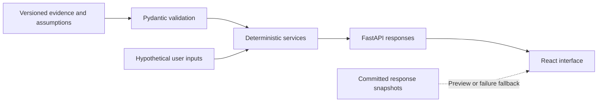

# PackShift: evidence-aware packaging decision support

[Project and local demo](../README.md) · [Public preview](https://denis100strike.github.io/packshift/) · [Exact demo-mode behavior](demo-modes.md)

## Problem and challenge context

PackShift is a Team SoS prototype developed for the GigaHack 2026 AgriFood / Profi
challenge. The team's proposed physical solution concerns sustainable high-temperature
food packaging; the software supports evidence review and qualification planning.
Reducing virgin plastic is one objective, but a numerically attractive package can still
be incompatible with the operating workflow or lack necessary supplier evidence.

The implemented value is deterministic decision support, not an LLM application or a
certified packaging product. The central distinction is **calculation ≠ operational
eligibility ≠ implementation approval**. [Challenge canon](canon/challenge_canon.md)
separates official scope, mentor clarification, and team decisions.

## Architecture

FastAPI loads versioned JSON through strict Pydantic contracts into startup snapshots.
Pure services compute Comparison, Portfolio Selection, hypothetical economics, and an
additive HTF-03 recommendation response. The React/TypeScript/Vite client displays
results and submits scenario inputs; it also contains recorded-response fallbacks and
a separate illustrative showcase calculator.

The [API composition](../backend/app/main.py), [evidence loader](../backend/app/runtime/context.py),
and [client](../frontend/src/api/client.ts) expose these boundaries. A backend failure
does not create replacement evidence, but frontend fallback can still make a saved
result appear successful. Demo disclosure is therefore part of interpreting the output.

## Environmental calculation boundaries

[Virgin-plastic arithmetic](../backend/app/services/virgin_plastic.py) sums
`plastic_mass_g × (1 − recycled_content_fraction)` over represented components and
compares current and candidate totals. Negative deltas remain negative. Missing mass
or recycled fraction stays unknown; it is not replaced with zero. If required inputs
are missing, the comparison returns `INSUFFICIENT_DATA` with unavailable metrics.

The component inventory matters: a container body is not automatically a complete
package including its lid, label, or adhesive. Public examples retain boundary qualifiers.
This metric is not lifecycle carbon, recyclability, shelf life, or a comprehensive
environmental score. [Calculation tests](../backend/tests/test_virgin_plastic.py) cover
missingness, signs, provenance, and the separation of numerical and operational results.

## Evidence provenance

The repository distinguishes PUBLIC source evidence, illustrative fixtures, derived
values, estimates, assumptions, and unknowns. [PUBLIC comparisons](../data/evidence/public-packaging.json)
are not a Profi provider dataset. User volume and cost inputs are hypothetical, not
observed commercial facts. Research provenance does not automatically qualify a
supplier's exact configuration for food contact or a particular thermal workflow.

The [HTF-03 loader](../backend/app/runtime/recommendation.py) validates the canonical
research and display projection, source references, configuration/context bindings,
and gate rows. Estimated central values remain estimates after integration; a populated
dashboard is not proof that a measurement or supplier qualification occurred. The
[evidence semantics](evidence_semantics.md) and field-level ledgers support inspection.

## Operational eligibility and recommendation

The Comparison/Selection gate distinguishes `BLOCKED` for a demonstrated incompatibility,
`REVIEW_REQUIRED` for unmodeled or unverified decision-critical premises, and `ELIGIBLE`
only under the bounded evaluated requirements. The modeled thermal and microwave
checks do not constitute comprehensive packaging qualification.

Separately, [HTF-03 recommendation](../backend/app/services/recommendation.py) reads
product/workflow/configuration-specific evidence across physical fit, food contact,
thermal workflow, grease/leak behavior, transparent viewing, and procurement gates.
`QUALIFICATION REQUIRED` and a first qualification path describe further work, not
implementation approval. The six-gate vocabulary is distinct from Selection eligibility;
neither can be replaced by an attractive plastic-reduction percentage.

## Portfolio Selection

[Selection](../backend/app/services/selection.py) checks comparability and exact recycled-content
point values before calculating a transition. A supplier's “up to” ceiling is not a
point estimate. Known individual totals can remain available while a mismatched boundary
withholds the transition delta. Candidate grouping is deterministic and preserves source
order within groups; it is not global ranking or optimization.

Optional annual units linearly scale a supported signed delta. Missing evidence remains
unavailable, and blocked calculated results remain theoretical/non-actionable. Next
actions are backend-authored evidence and QA guidance. An `is_actionable` field does not
grant purchasing or deployment approval. [Selection tests](../backend/tests/test_selection.py)
cover those distinctions.

## Hypothetical economic evaluation

The [economic service](../backend/app/services/economics.py) implements packaging-cost
arithmetic: current/candidate annual spend, signed cost delta, optional first-year
transition cost, and cost per kilogram avoided when a positive environmental delta
exists. Inputs retain `USER_PROVIDED` / `NOT_VERIFIED`; eligibility is carried through.
It is not verified Profi pricing or a complete ROI/TCO/LCA model. The
[economics tests](../backend/tests/test_economics.py) cover missing values and blocked
cases. This corrects the older README statement that no cost calculation existed.

## Demo modes, testing, and collaboration

The public GitHub Pages URL is a static preview using committed responses after API
failure. Selection overrides there replay the default portfolio assessment; recommendation
uses saved product/workflow combinations. The showcase's browser-side arithmetic is
separate from the backend evaluator. [Demo modes](demo-modes.md) lists supported inputs,
snapshot identities, limitations, and a reproducible local launcher.

[CI](../.github/workflows/ci.yml) runs backend tests, TypeScript/Vite build, and the
HTTP demo preflight. A separate [workflow](../.github/workflows/htf-03-validation.yml)
validates HTF-03 evidence changes. Green software checks do not certify the packaging.

Vladimir Barbalat's **Team Lead** role is owner-supplied. Merged history supports his
integration reconciliation [#4](https://github.com/Slave-of-Skynet/gigafood/pull/4),
eligibility correctness [#6](https://github.com/Slave-of-Skynet/gigafood/pull/6), and
Selection/UI/demo integration [#19](https://github.com/Slave-of-Skynet/gigafood/pull/19).
Igor's Selection/economics/recommendation backend, Denis's UI integration, Alisa's
data-modeling/presentation/QA work, and Vadim's distinct Product Owner/physical-concept
role remain credited with [representative PRs](../README.md#team-contributions).
Integration does not imply sole authorship.

## Limitations

No customer adoption, actual Profi savings, competition award, physical certification,
or production readiness is established here. Recommendation fallback lacks a clear
live-versus-recorded indicator, and the showcase/certificate presentation includes claims
that cannot serve as qualification evidence. Those are documented follow-ups, not fixes
in this PR. Real deployment would require configuration-specific supplier evidence,
physical testing, and an explicit human decision beyond this prototype.
